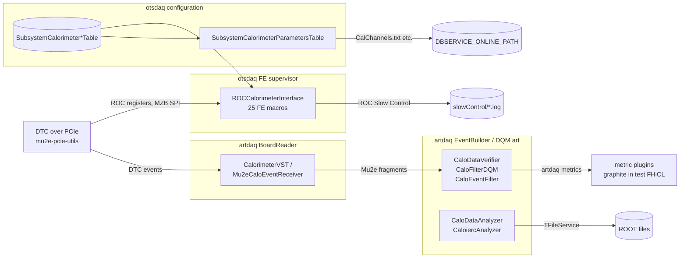

# otsdaq-mu2e-calorimeter

> Calorimeter subsystem plugins for otsdaq-mu2e and artdaq-mu2e: the DIRAC/MZB
> ROC front-end interface, two DTC fragment generators, six art modules for
> data verification, DQM metrics and analysis, and the table plugin that
> exports calorimeter channel tables for the online trigger.

| | |
|---|---|
| Repository | `Mu2e/otsdaq-mu2e-calorimeter` (public, default branch `develop`) |
| Language | C++17 (cetmodules 3.16 build), FHiCL, ROOT macros |
| Version | 9.01.00 (`CMakeLists.txt:13`) |
| Ports | none bound |
| Depends on | `otsdaq-mu2e`, `artdaq-mu2e`, `artdaq-core-mu2e`, `mu2e-pcie-utils`; Offline ≥ 11.00.00 |
| Review tier | B — structural and interface only |

## Purpose

A plugin library. It ships no executables and runs no service; otsdaq and
artdaq processes load its shared objects by plugin name from their
configuration. The interfaces are catalogued in [INTERFACES.md](INTERFACES.md).

## Architecture

## Components

- `FEInterfaces/` — `ROCCalorimeterInterface`, a `ROCPolarFireCoreInterface`
  subclass from `otsdaq-mu2e`, plus the MZB (mezzanine board) command-encoder
  library `MZB.C`/`MZB.h`.
- `Generators/` — two artdaq commandable generators built on
  `artdaq-mu2e::Mu2eReceiverBase`. `STIBReceiver` is present but not built.
- `ArtModules/` — six art modules; three more sources are present but not built.
- `TablePlugins/` — `SubsystemCalorimeterParametersTable`.
- `boardConfig/` — installed data: per-board CSVs and the slow-control log
  directory with `slow_control_summary.sh`.
- `scripts/` — expert ROOT macros (`otsdaq-mu2e-calorimeter-root-macros(7)`).
- `test/` — hand-run FHiCL; not built.
- `UserWebGUI/` — otsdaq web-app pages; not reviewed.

## Interactions with other packages

| Package | Mechanism | Evidence |
|---|---|---|
| `otsdaq-mu2e` | link: FE base class, `find_package` | `FEInterfaces/CMakeLists.txt:18`, `CMakeLists.txt:71` |
| `artdaq-mu2e` | link: `Mu2eReceiverBase` | `Generators/CMakeLists.txt:5` |
| `artdaq-core-mu2e` | link: overlays and calorimeter decoder | `ArtModules/CMakeLists.txt:7` |
| `mu2e-pcie-utils` | link: `DTCInterface` | `Generators/CMakeLists.txt:5` |
| `otsdaq-mu2e-config` | table schemas (`SubsystemCalorimeter*TableInfo.xml`); sets `DBSERVICE_ONLINE_PATH` | `otsdaq-mu2e-config/hwdev_spack_fast_setup_ots.sh:702` |

## Review findings

Staged in [ISSUES-PENDING.md](ISSUES-PENDING.md) and listed in
[package.yaml](package.yaml).
